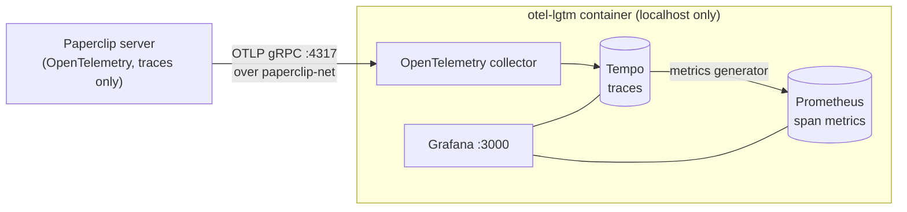

<div align="center">

# Paperclip Grafana

**See how fast your Paperclip agent runs start, answer and finish, and where the time goes.**
A local Grafana dashboard for [Paperclip](https://github.com/paperclipai/paperclip)'s OpenTelemetry traces: run health and duration, startup and first-token latency, agent turns and tools, workspace sync, controller recovery, budget checks, API and database performance, and **full trace waterfalls**. One command to install, everything stays on your machine.

[](LICENSE)


[](https://github.com/ViezeVingertjes/paperclip-grafana/stargazers)
[](https://github.com/ViezeVingertjes/paperclip-grafana/commits/main)
[](https://github.com/ViezeVingertjes/paperclip-grafana/actions/workflows/ci.yml)

</div>

> **Unofficial.** This project is not affiliated with or endorsed by Paperclip. It reads telemetry that Paperclip itself emits.

## Highlights

- **Health at a glance.** Green, orange or red tiles that compare *now* with *your own* last 7 days (run failures, tool failures, run duration, time to first token, startup, preparation). No magic thresholds, so they fit any setup.
- **Runs, for any agent.** Throughput and failures, duration percentiles, average concurrent runs, recent, slowest and failed runs with a link to each trace. Built on the executor span every adapter emits.
- **Where run time goes.** Preparation phases, run configuration, skills, execution and completion, each broken down.
- **Native runner** (`paperclip_runner` agents). Time to first token, Runner startup, fresh versus resumed sessions, turn duration, tool executions, failures and latency per tool, turns by provider, sessions by harness.
- **Workspace.** Where workspace sync spends its time, the slowest preparation steps, repository checkout cache outcomes and data moved.
- **Controller, budget and chat.** Startup and recovery phases and their errors, budget admission and accounting (including lock waits), Slack receipt reactions.
- **API.** HTTP requests, latency and status codes by method, slowest requests, task-detail read phases.
- **Trace waterfalls.** Click a run and see every phase on a timeline.
- **Several instances.** Give each Paperclip an `OTEL_SERVICE_NAME` and filter or compare them with the *Instance* variable.
- **Easy to read.** Short names instead of raw span names, rates instead of raw counts so charts read the same at 15 minutes or 7 days, and a clear "none in this range" when there is nothing to show.

## Paperclip only exports traces. Where do the numbers come from?

From the traces. Paperclip's OpenTelemetry support exports **spans and nothing else** (no metrics, no logs), so this
dashboard derives every number from them, in two ways that each fix the other's limit:

| | Span metrics (PromQL) | TraceQL metrics (Tempo) |
|---|---|---|
| **What** | Tempo counts and times spans into Prometheus series | Tempo computes `rate()`, `count_over_time()`, `quantile_over_time(duration, ...)` from stored spans on demand |
| **Used for** | Rates, error ratios, the health tiles ("vs usual"), alert rules | Every percentile of a run, turn or startup, and every breakdown by a Paperclip attribute (provider, tool, cache outcome, route ...) |
| **Limit** | Latency histogram stops at **16.4 s**; no span attributes | Only recent data; heavier to compute |

Agent runs last minutes, so percentiles can never come from the span-metric histogram. The health tiles use *means*
(sum / count, exact at any length) because "now divided by usual" needs PromQL. Details in
[`docs/telemetry-reference.md`](docs/telemetry-reference.md).

## Quick start

You need Linux with systemd, [Podman](https://podman.io/) 4.4 or newer, `curl` and `python3`, and a Paperclip image
(for example one built from the [Paperclip repository](https://github.com/paperclipai/paperclip) with
`podman build --target production ...`; see the note under [Troubleshooting](#troubleshooting)).
On Debian or Ubuntu: `sudo apt-get install -y podman curl python3`.
On macOS, Windows or without systemd, use [Docker Compose](#docker-compose) instead.

```bash
git clone https://github.com/ViezeVingertjes/paperclip-grafana.git
cd paperclip-grafana
./install.sh --build-image paperclip-local --paperclip-env /path/to/paperclip.env
```

Then run Paperclip **from the new `paperclip-otel` image on the `paperclip-net` network**, for example
`podman run -d --network paperclip-net --env-file /path/to/paperclip.env ... paperclip-otel`, and open
<http://127.0.0.1:3000>. Log in with `admin` / `admin` and **change the password**. The Paperclip dashboard is the home
page. The first start downloads the Grafana image, which can take a few minutes. The script waits for it.

Paperclip reads its OpenTelemetry settings at startup, so **restart it** after changing them. Check its log for
`[paperclip] OpenTelemetry service.version=<commit>`; a line saying the `@opentelemetry/*` packages are missing means it
is not running from the `paperclip-otel` image.

<details>
<summary>What <code>install.sh</code> does</summary>

1. Checks that Podman, systemd, curl and Python are available (clear message if not).
2. Installs a rootless **systemd user service** (`otel-lgtm.service`, a Podman Quadlet) that runs [`grafana/otel-lgtm`](https://github.com/grafana/docker-otel-lgtm): Grafana, Tempo (traces), Loki (logs), Prometheus (metrics) and an OpenTelemetry collector, bound to localhost, plus a Podman network `paperclip-net` that Paperclip joins.
3. Provisions the dashboard and removes the image's sample dashboards.
4. Enables *lingering* (`loginctl enable-linger`) so the stack starts at boot without a login. Skip with `--no-boot`.
5. With `--build-image [BASE]`: builds the `paperclip-otel` image from a Paperclip image, adding the exact-version OpenTelemetry packages Paperclip requires.
6. With `--paperclip-env FILE`: adds the export variables to that env file (a backup `FILE.bak-pre-otel` is made first).

It is safe to run again. See `./install.sh --help`.
</details>

## How it works



Paperclip sends **spans**: a trace per agent run (preparation, Runner startup, agent turns, tools, settlement), the
server's preparation and workspace phases, controller recovery, budget checks, and the HTTP and database spans from the
auto-instrumentation. Tempo stores them and generates span metrics; Grafana queries both.

## Paperclip needs its OpenTelemetry packages

Paperclip only imports its OpenTelemetry SDK when you install it, and only at the exact versions in its
`server/package.json`. [`paperclip-otel/Containerfile`](paperclip-otel/Containerfile) adds them to an existing Paperclip
image (`./install.sh --build-image`). If you run Paperclip another way, install the same packages next to the server
(`pnpm add @opentelemetry/sdk-node@0.221.0 ...`, see Paperclip's `doc/observability.md`) and set the variables from
[`paperclip-otel/paperclip-telemetry-env.json`](paperclip-otel/paperclip-telemetry-env.json). With Paperclip on the host,
use `--endpoint http://127.0.0.1:4317`.

## How the colours work

Green, orange and red always mean *fine*, *watch this* and *act*; everything else stays neutral, so a colour always means something.

**The Health row** is not tied to one setup. Each tile compares the selected range with **your own last 7 days**:

| Tile | Rule |
|---|---|
| Run failure rate | failure share now / over 7 days (lightly smoothed) |
| Run duration, run configuration, workspace preparation, API latency | mean now / mean over 7 days. 1.00x = as usual |
| Failed runs, API server errors, controller errors | counts; a healthy setup has none, so any occurrence is orange |

Ratios turn orange at 1.5x and red at 2.5x of usual. With less than 7 days of history the baseline is just the data you
have, so tiles read about 1.00x until something changes. Adjust the steps in `tools/gen_dashboard.py` (`UP`, `ANY`, `BASE`).

**A few tiles use fixed lines** because "good" is the same for everyone: run success rate and tool success rate (orange
below 95%, red below 85%). Chart colours carry no health meaning: failed is red and OK green, p95 series are dashed.

## Customising the dashboard

`dashboards/paperclip.json` is generated. Edit [`tools/gen_dashboard.py`](tools/gen_dashboard.py) and regenerate; Grafana reloads the file within about 30 seconds (edits made in the Grafana UI are overwritten):

```bash
python3 tools/gen_dashboard.py > dashboards/paperclip.json
python3 tools/validate_dashboard.py --range 24h   # runs every query; 15m, 3h, 24h or 7d
```

The validator queries Grafana anonymously; set `GRAFANA_PASSWORD` if anonymous viewing is off. CI runs the same check on
every push: it starts the stack with `docker compose up -d`, feeds it with `tools/send_sample_telemetry.py` (Paperclip-shaped
sample traces, because there is no Paperclip in CI), and runs the validator against that, so a query that errors against a
live Grafana fails the build. **Never run the sample sender against a stack that holds your real telemetry.**

Names and empty states are set in one block near the end of the script (`RENAMES`, `EMPTY_IS_GOOD`, `STAT_STEPS`), so a
new span name never means touching a query.

## Docker Compose

On macOS, Windows, or anywhere without systemd, use the compose file (Grafana stays on localhost):

```bash
docker compose up -d                                   # Grafana, Loki, Tempo, Prometheus and the collector
podman build -t paperclip-otel -f paperclip-otel/Containerfile --build-arg BASE=<your paperclip image> paperclip-otel
python3 paperclip-otel/apply-paperclip-otel.py /path/to/paperclip.env
```

Run Paperclip from `paperclip-otel` on the `paperclip-net` network the compose file creates.

## Using your own Grafana

Import [`dashboards/paperclip.json`](dashboards/paperclip.json) (also attached to every release) under *Dashboards > New >
Import*, or run `GRAFANA_URL=... GRAFANA_PASSWORD=... python3 tools/import_dashboard.py`. You need a Prometheus and a
Tempo datasource that receive Paperclip's OTLP data, with Tempo's **metrics generator** (span metrics) and **TraceQL
metrics** enabled, as in `grafana/otel-lgtm`. The dashboard picks the first datasource of each type; change
`ds_prometheus` and `ds_tempo` under *Dashboard settings > Variables* if you have several. An already running stack must
also share a network with Paperclip: `podman network connect paperclip-net otel-lgtm`.

## Alert examples

[`examples/alerting/`](examples/alerting/) has Grafana alert rules in provisioning format for four common cases: a
failed run, a failed controller phase, no spans for 15 minutes, and a slow time to first token. Copy the ones you want,
adjust the datasource uid, service name and threshold, and wire up a contact point; see that folder's README.

## Operating it

```bash
systemctl --user status otel-lgtm.service       # health
systemctl --user restart otel-lgtm.service
journalctl --user -u otel-lgtm.service -f       # logs
./install.sh --uninstall                        # removes the services, keeps your data
```

Data lives in `~/.local/share/otel-lgtm` (`docker compose down -v` for the compose install); delete it to wipe all stored telemetry. `python3 paperclip-otel/apply-paperclip-otel.py FILE --remove` takes the variables out of the env file again.

## Troubleshooting

| Symptom | Cause and fix |
|---|---|
| Dashboard is empty | Paperclip reads its OpenTelemetry settings at startup: restart it. Check the *Spans per minute* tile and Paperclip's log. |
| Paperclip logs "the @opentelemetry/* packages are not installed" | Run it from the `paperclip-otel` image (`./install.sh --build-image`), at the versions its `server/package.json` declares. |
| Paperclip cannot reach the collector | A container cannot use a port published on the host's `127.0.0.1`. Put both on `paperclip-net` and export to `http://otel-lgtm:4317`; for a stack started by something else, `podman network connect paperclip-net otel-lgtm`. |
| Percentile panels are empty but counts are not | Percentiles come from TraceQL metrics, which only cover recent data; run something and look at a short range. |
| Native runner runs fail with `admission_installation` | You built Paperclip's last Dockerfile stage, the `cloud` variant, which adds a nested `/app/server/node_modules/.pnpm` and breaks the runner sidecar's provider-package lookup. Build with `--target production`, which is what Paperclip's own CI pins. |
| Native runner runs fail with `session_ensure_failed` | The native runner starts the agent in a sanitized environment and does not see the host's Claude login. Give the agent a credential it accepts: `CLAUDE_CODE_OAUTH_TOKEN` (a subscription token) or `ANTHROPIC_API_KEY`, through Paperclip's secrets or the agent's connection setup. |
| Stack does not start at boot | Lingering is off: run `sudo loginctl enable-linger $USER`. |
| "Port already in use" | Something else uses 3000, 4317 or 4318 on localhost. Free it and re-run `./install.sh`. |
| A *Native runner* panel is empty | Those spans only exist for agents with the `paperclip_runner` adapter, on a task in `standard`, `planning` or `ask` mode. Legacy adapters such as `claude_local` fill every other row. Detail spans are also capped at 16 per name per attempt. See [`telemetry-reference.md`](docs/telemetry-reference.md). |

## Privacy and security

- Everything listens on `127.0.0.1`. Nothing is sent anywhere, except the image download from Docker Hub. Paperclip reaches the stack over a private Podman network.
- Paperclip's spans carry a closed list of attributes: hashed run IDs, counts, durations and enumerated names. Prompts, responses, tool arguments, workspace paths and exception messages are not exported.
- The HTTP auto-instrumentation records the request path (`url.path`), which can contain task or agent IDs; the *Slowest API requests* panel shows it. Remove that column in `tools/gen_dashboard.py` if you do not want paths on screen.
- Grafana ships with `admin` / `admin`: change it on first login. No credentials are stored in this repository.

## Layout

| Path | Purpose |
|---|---|
| `install.sh` | Installs and uninstalls the Podman + systemd setup (`--help` lists the options) |
| `docker-compose.yml` | The Docker alternative |
| `dashboards/paperclip.json` | The generated dashboard |
| `tools/gen_dashboard.py` | **Source of truth** for the dashboard |
| `tools/validate_dashboard.py` | Runs every dashboard query at a chosen range |
| `tools/import_dashboard.py` | Imports the dashboard into an existing Grafana |
| `tools/send_sample_telemetry.py` | Pushes Paperclip-shaped sample traces, for CI only |
| `provisioning/`, `quadlet/` | Grafana dashboard provisioning, and the Podman service and network templates |
| `paperclip-otel/` | The Containerfile that adds Paperclip's OpenTelemetry packages, the export variables and the script that merges them into an env file |
| `tests/` | Unit tests (`python3 -m unittest discover -s tests -t .`) |
| `docs/` | [Telemetry reference](docs/telemetry-reference.md), [FAQ](docs/faq.md), [upgrade notes](docs/upgrading.md) |
| `examples/alerting/` | Grafana alert rule examples |
| `.github/` | CI, issue and pull request templates, and the contributing, security and conduct documents |
| `CHANGELOG.md` | What changed in each release |

## Compatibility

Tested with Paperclip `b31ec0a` (OpenTelemetry packages `sdk-node` 0.221.0, `auto-instrumentations-node` 0.79.0),
`grafana/otel-lgtm` 0.39.0 (Grafana 13.3, Tempo 3.1) and Podman 5.7. Paperclip renames spans between versions, so other
versions may leave panels empty. Issues and pull requests are welcome, especially reports from other versions.

## Contributing

Issues, ideas and pull requests are welcome; see [CONTRIBUTING](.github/CONTRIBUTING.md). Questions and "how do you use it" belong in [Discussions](https://github.com/ViezeVingertjes/paperclip-grafana/discussions). Security problems: [SECURITY](.github/SECURITY.md).

## License

[MIT](LICENSE)
